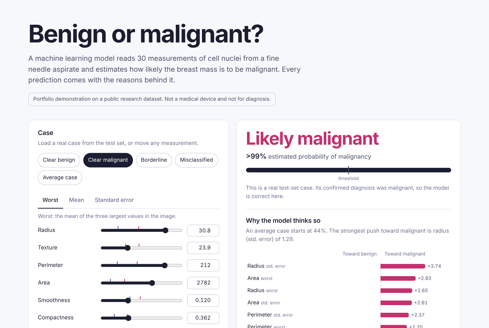
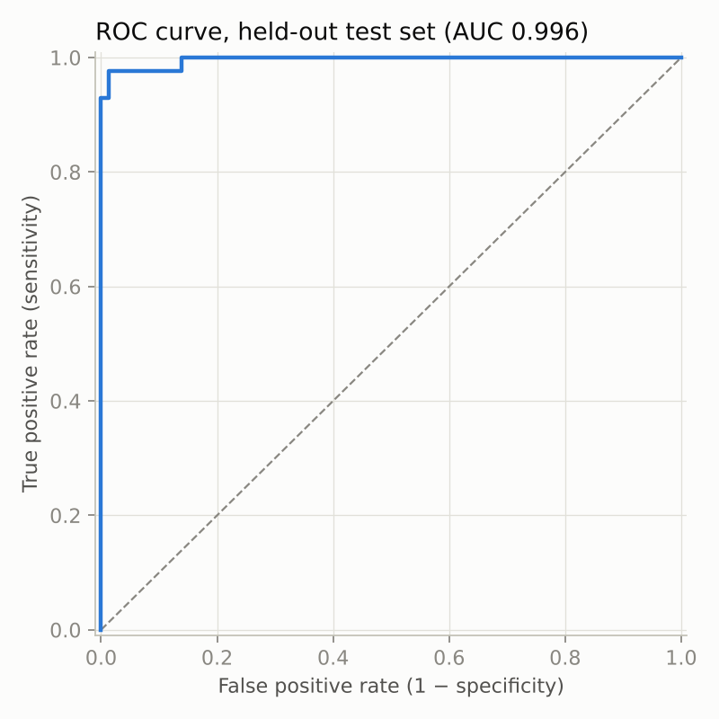
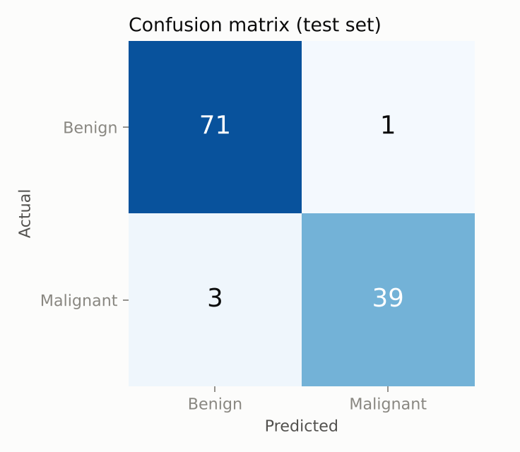
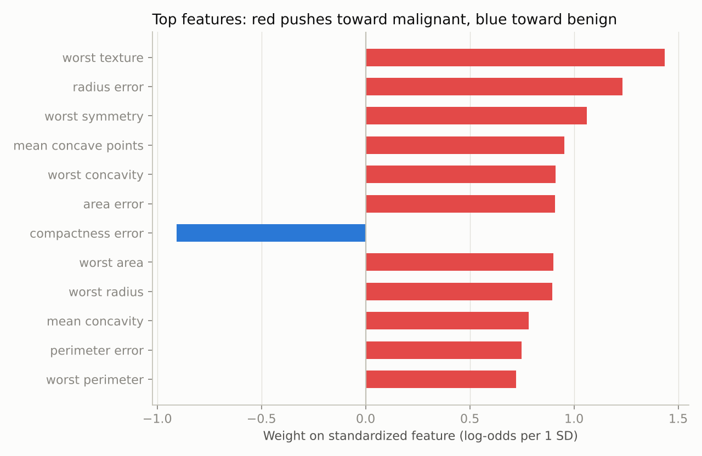

# Breast Cancer Classification with Explainable AI

[](https://github.com/addiboak100-hue/breast-cancer-xai-dashboard/actions/workflows/ci.yml)


**[Live demo](https://addiboak100-hue.github.io/breast-cancer-xai-dashboard/)**

A machine learning model that classifies a breast mass as **benign or malignant** from 30 measurements of cell nuclei, and explains every prediction: which measurements pushed it toward malignant, which toward benign, and by how much.



> Portfolio project on a public research dataset. Not a medical device and not for diagnosis.

## Highlights

- **96.5% accuracy and 0.996 ROC AUC** on a held-out test set the model never saw during training or tuning.
- **Exact explanations, not approximations.** The deployed model is a logistic regression, so each prediction decomposes into additive per-feature contributions that sum precisely to the output. For a linear model these equal the SHAP values.
- **Interpretability at no cost.** In cross-validation the logistic regression beat SVM, random forest and gradient boosting, so the most transparent model was also the most accurate.
- **Clinical framing.** An interactive decision threshold shows the trade-off between catching cancers (sensitivity) and avoiding false alarms (specificity). Lowering it from 50% to 30% catches 41 of 42 malignant test cases instead of 39.
- **Runs entirely in the browser.** The dashboard is static HTML and JavaScript on GitHub Pages: no server, and no data leaves the page.
- **Tested.** Unit tests check that the browser's maths reproduces scikit-learn exactly and that model quality stays above a floor; GitHub Actions runs them on every push.

## Results

Held-out test set (114 cases, 20% stratified split), threshold 0.5:

| Metric | Value |
|---|---|
| Accuracy | 96.5% |
| Sensitivity (malignant caught) | 92.9% (39 / 42) |
| Specificity (benign cleared) | 98.6% (71 / 72) |
| Precision | 97.5% |
| ROC AUC | 0.996 |
| Brier score | 0.021 |

Model comparison, 5-fold stratified cross-validation on the training set:

| Model | ROC AUC | Sensitivity | Accuracy |
|---|---|---|---|
| **Logistic regression (deployed)** | **0.996** | **95.3%** | **97.4%** |
| SVM (RBF kernel) | 0.995 | 94.7% | 97.1% |
| Gradient boosting | 0.991 | 94.7% | 96.7% |
| Random forest | 0.988 | 93.5% | 96.0% |

<p>
  
  
</p>



## How the explanations work

With standardized inputs, the model's log-odds of malignancy is

```
logit(x) = b0 + Σ wᵢ · (xᵢ − μᵢ) / σᵢ
```

Each term `wᵢ · (xᵢ − μᵢ) / σᵢ` is the contribution of measurement *i* relative to an average training case (whose terms are all zero). The dashboard draws these terms as the bars under "Why the model thinks so", so the explanation is the model itself, not a separate approximation of it. The training script asserts that this hand-written form reproduces scikit-learn's `decision_function`, and a test re-implements the browser's formula from the exported JSON to confirm the predictions match.

## Dataset

[Wisconsin Diagnostic Breast Cancer (WDBC)](https://archive.ics.uci.edu/dataset/17/breast+cancer+wisconsin+diagnostic), loaded through scikit-learn: 569 cases (357 benign, 212 malignant). Ten properties of cell nuclei (radius, texture, perimeter, area, smoothness, compactness, concavity, concave points, symmetry, fractal dimension) are each recorded as a mean, a standard error and a "worst" value, giving 30 features.

## Method

1. **Split:** stratified 80/20 train/test split with a fixed seed. The test set is used once, for the final evaluation.
2. **Compare:** four model families in identical `StandardScaler → classifier` pipelines, scored by 5-fold stratified cross-validation on the training set only (no leakage).
3. **Tune:** grid search over the logistic regression's regularization strength `C`, optimizing ROC AUC.
4. **Evaluate** on the test set and **export** the scaler statistics, coefficients, metrics and per-case test predictions to `docs/model.json` for the dashboard.

## Run it locally

```bash
git clone https://github.com/addiboak100-hue/breast-cancer-xai-dashboard.git
cd breast-cancer-xai-dashboard
python -m venv .venv && source .venv/bin/activate   # Windows: .venv\Scripts\activate
pip install -e ".[dev]"

python -m bcxai.train          # train, evaluate, export docs/model.json and figures
pytest                         # run the tests
python -m http.server -d docs  # open http://localhost:8000
```

## Project structure

```
├── src/bcxai/
│   ├── data.py        # loading, target encoding (malignant = 1), stratified split
│   ├── explain.py     # exact per-feature contributions for the linear model
│   └── train.py       # model comparison, tuning, evaluation, export, figures
├── docs/              # static dashboard served by GitHub Pages
│   ├── index.html
│   ├── app.js         # prediction + explanations recomputed in the browser
│   ├── style.css
│   └── model.json     # exported model (generated)
├── reports/           # metrics.json and figures (generated)
├── tests/             # pytest suite
└── .github/workflows/ci.yml
```

## Limitations

- **Small, single-source data.** 569 cases from one institution in the 1990s. Performance on other populations, imaging equipment or labs is unknown; a model like this would need external validation and regulatory review before any clinical use.
- **Correlated features.** Radius, perimeter and area describe almost the same thing, so individual weights should be read as a group. A negative weight on one size-related feature mostly corrects for its correlated neighbours rather than meaning "bigger is safer".
- **Small test set.** With 42 malignant test cases, one more or one fewer miss moves sensitivity by about 2.4 points, so the cross-validation figures are a useful second estimate.
- **Contributions are relative to an average case**, not causal effects. They explain what the model does, not the biology.

## License

MIT. Dataset: W. N. Street, W. H. Wolberg and O. L. Mangasarian, *Nuclear feature extraction for breast tumor diagnosis*, 1993, via the UCI Machine Learning Repository.
